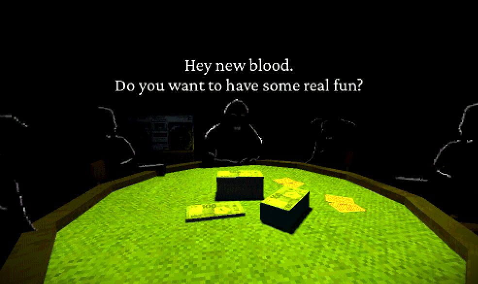

# Invite Only

Atmospheric point and click adventure made in a week for The Very Serious Juniper Dev Game Jam. With full voice acting and an original soundtrack by my friend Snoozeds!

> **Have you ever gamed at a party with your life on the line?**
>
> You are invited to an exclusive party hosted by some shady figures. You don't know anyone, but they clearly know you.
>
> I hope you are ready to game like your life depends on it. You wouldn't want to disappoint The Boss, right?

> [!IMPORTANT]  
> This repo does not include PSX Mega Pack assets used in the game, because posting them here would be piracy.

## Credits

Developer
* [Punished Bernadetta](https://detta.dev/)

Music (OST available at https://on.soundcloud.com/xxRoRLqegxl5GwDD4D)
* [Snoozeds](https://snoozeds.com/)

Super Hib Party announcer VA
* [Crumb](https://bsky.app/profile/crumb101.bsky.social)

Additional sound effects and outro VA
* [flower](https://x.com/xfreshcutflower)

## Development facts!
* Poker table texture is my towel hue shifted towards green
* Names of playable characters are Baguette (Teto plushie), Gerald (Blahaj), and Hibi (plushie with a yellow hibiscus)
* For poker players I asked my roommate to sit like he's at a poker table and then traced him
* Car is literally just doors, front panel, and roof
* For the "beer drinking" sound effect I actually just sat really close to the microphone while drinking out of soda can
* Car was a VERY late addition so that area is a bit buggy and laggy...
* Originally there was supposed to be an sequence where the game would be paused because Leader got a call - something about a rat! Your heart is pounding, you are terrified of what might happen to you, and then he comes back and says "Yeah, wife found a rat in the apartment. That's what I get for living in NYC".

## List of 3rd party assets
* Exterior, chairs, wooden floor - PSX Mega Pack by Pizzadoggy
* Boombox texture - Stephen Michael Barnett under Creative Commons Attribution 2.0 Generic license (compressed and PSX-ified)
* Madcatz Nintendo 64 Controller - https://www.virtualvideogamestore.com/store/p3141/Madcatz_Nintendo_64_Controller.html, Mad Catz logo replaced with BADASS FOXEZ
* Gravel texture - AmbientCG
* Skybox - AmbientCG
* Buckshot Roulette Style Shader - https://godotshaders.com/shader/buckshot-roulette-style-shader-2/
* Water shader - https://godotshaders.com/shader/wind-waker-water-no-textures-needed/
* Crimson Pro font - The Crimson Pro Project Authors under OFL
* Cherry Bomb One - The Cherry Bomb Project Authors under OFL
* Jerma crouching - https://www.youtube.com/watch?v=IFNZrRSBNSw
* Car interior - https://www.reddit.com/r/80sCarInteriors/

Shout outs to https://valsekamerplant.itch.io/texture-retrofier
